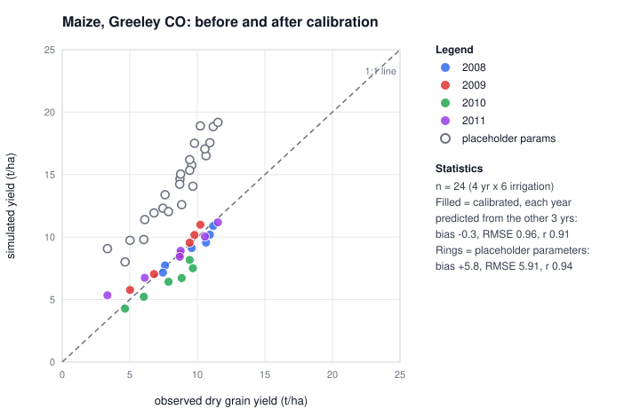

# radicle

A small crop simulator for wheat and maize: FAO-56 water balance, root-zone salinity, growth, and disease. Pure Python, no runtime dependencies.

> [!WARNING]
> Research code. Most parameters are placeholders and maize is calibrated for one site only. Not for farm decisions.

## Install and run
```bash
python3 -m venv .venv && .venv/bin/pip install -e . pytest
.venv/bin/radicle run data/greeley-2010-t1 --params maize_greeley   # a real maize plot
.venv/bin/radicle plot data/demo --out season.svg
.venv/bin/pytest -q
```
Other commands: `synth`, `validate`, `scenarios`, `calibrate`. Run `radicle -h`.

## Reproduce the results
```bash
.venv/bin/radicle reproduce          # writes results/*.json and a manifest (about 1 minute)
.venv/bin/python scripts/make_figures.py
```
Every reported number comes from `src/radicle/experiments.py`. Experiments whose data is missing are skipped.

## Results


| | Data | Result |
|---|---|---|
| Wheat, placeholder parameters | Nile trials, 22 irrigated plots | RMSE 1.65 t/ha, r 0.50 |
| Maize, placeholder parameters | Greeley, 24 plots | bias +5.8 t/ha |
| Maize, calibrated, year held out | Greeley, 24 plots | bias -0.3 t/ha, RMSE 0.96 |
| Reference ET (FAO-56) | Greeley, 601 days | r 0.97 vs published ETo |

More figures, data problems and caveats: [docs/DATA-SOURCES.md](docs/DATA-SOURCES.md).

## Data
- `data/demo/` is synthetic.
- `data/external/egypt-nile-wheat/` is real (CC BY 4.0). `data/greeley-2010-t1`, `-t6` are real (public domain).
- Larger datasets (Greeley maize, EU wheat trials) are git-ignored; download steps are in `docs/DATA-SOURCES.md`.

Field folders hold `weather.csv`, `soil.csv`, `management.csv` and optional `observations.csv`. Loaders reject bad values, unknown keys and missing rows with the file and line.

## Cite and licence
MIT, see `LICENSE`. Cite with `CITATION.cff` and cite the datasets you use. History: `CHANGELOG.md`.
